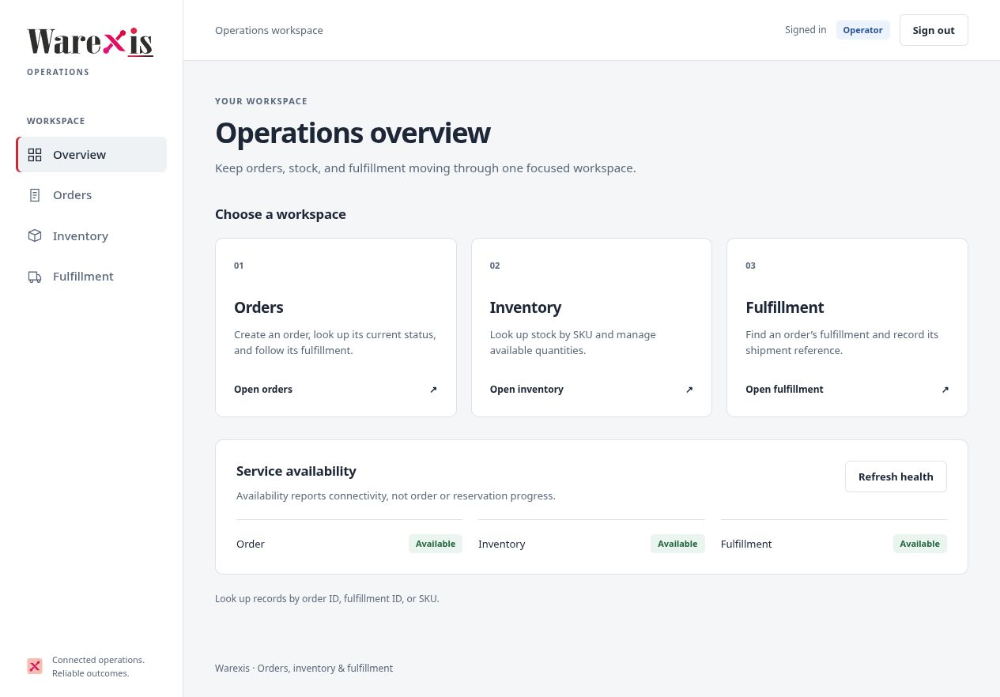
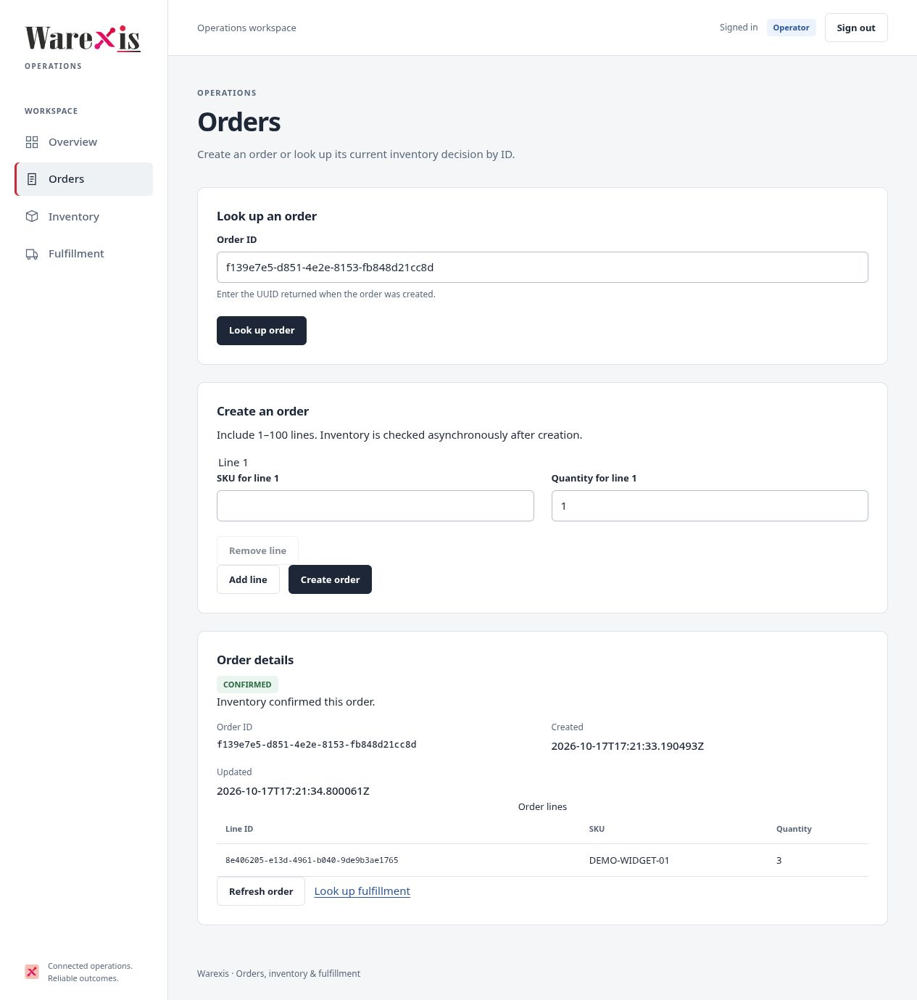
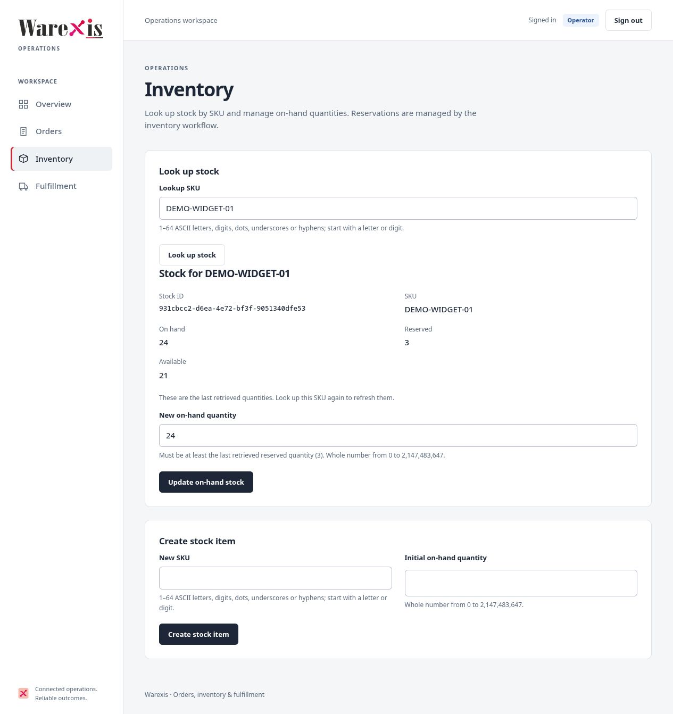
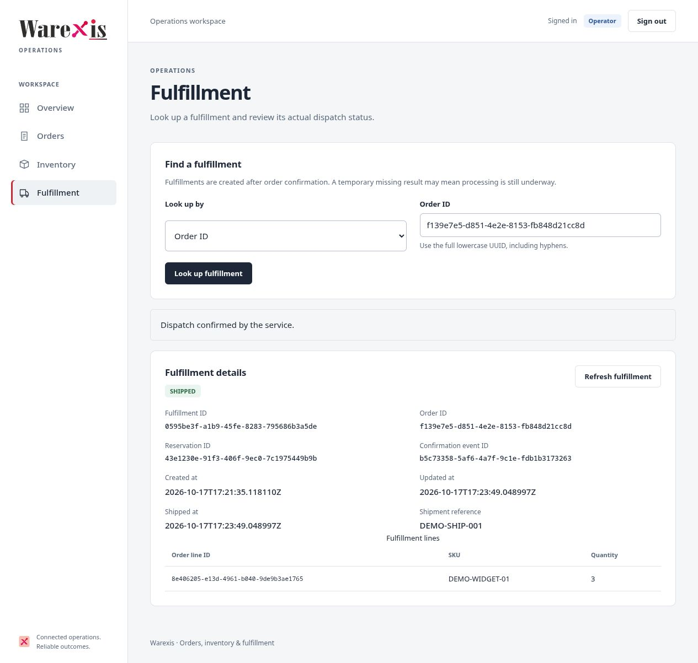
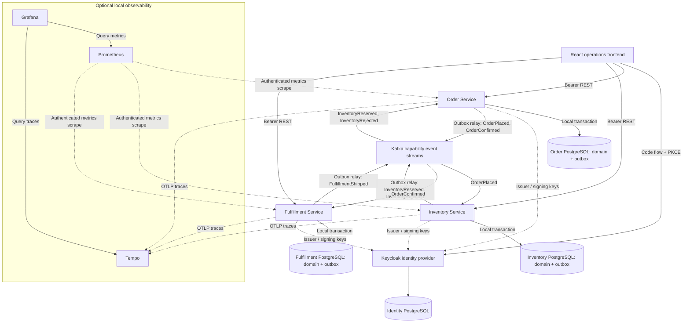

<picture>
  <source media="(prefers-color-scheme: dark)" srcset="frontend/public/brand/warexis-logo-light.svg">
  
</picture>

# Warexis

An event-driven order, inventory and fulfillment platform built as a personal engineering portfolio project. Three Java services coordinate stock reservations and manual dispatch through Kafka, with a React operations workspace and independently owned PostgreSQL databases.

## Application

Actual application screens using disposable business data:

| Dashboard | Orders |
| --- | --- |
|  |  |
| **Inventory** | **Fulfillment** |
|  |  |

## Implemented capabilities

- **Orders:** create and retrieve orders; follow asynchronous `PENDING_INVENTORY`, `CONFIRMED` or `REJECTED` outcomes.
- **Inventory:** create, look up and update stock by SKU; reserve every order line atomically or reject the entire reservation without changing stock.
- **Fulfillment:** create a plan from order confirmation, retrieve it by fulfillment or order ID, and record an idempotent manual dispatch with a shipment reference.
- **Operations workspace:** real service health, role-aware forms, explicit refresh, validation and uncertain-mutation recovery. Business records use ID/SKU lookups.
- **Identity and diagnostics:** Keycloak sign-in, Viewer/Operator authorization, optional authenticated metrics and distributed tracing, plus an optional local Kubernetes deployment.

## Architecture

REST handles browser commands and reads. Kafka carries business facts between services when messaging is enabled; it defaults off in standalone service configuration.



Each service controls its own schema and transactions; services exchange events instead of querying another service's database. Outbox rows commit with domain changes, then relays publish them to Kafka. Keycloak owns identity separately from business state. Observability is an optional local stack; it is not included in the Kubernetes manifests.

The [architecture overview](docs/architecture/overview.md) explains service boundaries, transaction guarantees and the complete sequence. See the [domain model](docs/architecture/domain-model.md), [event contracts](docs/architecture/event-contracts.md) and [frontend API contracts](docs/frontend/api-contracts.md) for exact interfaces.

## Order lifecycle and reliability

1. Order creation commits `PENDING_INVENTORY` and `OrderPlaced` together, then returns. A successful HTTP response does not imply reserved stock.
2. Inventory consumes `OrderPlaced`, locks stock rows in a deterministic order and commits either an all-or-nothing reservation with `InventoryReserved` or a rejection with `InventoryRejected`.
3. Order accepts the first valid outcome. Confirmation commits `CONFIRMED` and `OrderConfirmed`; rejection becomes `REJECTED`.
4. Fulfillment consumes `OrderConfirmed` to create one `PENDING` plan. An operator's ship command commits `SHIPPED` and `FulfillmentShipped`; no current service consumes that event.

Kafka decouples order acceptance from downstream availability, with eventual consistency between services. Delivery is at least once: durable event deduplication, business uniqueness and local transactions prevent duplicate effects. Persisted retry budgets, consumer-specific dead-letter topics and explicit recovery bound failures. See the [Kafka recovery guide](docs/architecture/kafka-workflow.md).

## Technology and security

| Area | Implementation |
| --- | --- |
| Backend | Java 21, Spring Boot 4.1.1, Spring Kafka, Spring Security, JPA/Hibernate, Maven |
| Persistence and messaging | PostgreSQL 18.6, Flyway, Apache Kafka 4.2.2 |
| Frontend | React 19, TypeScript, Vite, Keycloak JavaScript adapter |
| Identity | Keycloak 26.8.0, OAuth2/OIDC, Authorization Code with PKCE S256 |
| Verification | JUnit, Testcontainers, Vitest, Testing Library, Playwright |
| Infrastructure | Docker Compose, local kind/Kubernetes, Prometheus, Grafana, OpenTelemetry and Tempo |

APIs validate JWT signature, issuer, audience and realm roles. Viewer access permits reads; Operator access permits mutations. Browser tokens stay in memory and refresh before protected requests; the backend remains the authorization authority. See the [security model and endpoint matrix](docs/architecture/security.md).

## Local development

Prerequisites: Java 21, Docker Engine with Compose, and Node 24 (at least 24.15) with npm. Maven wrappers are included.

1. From the repository root, create an ignored local environment file if one does not exist:

   ```sh
   test -e .env || cp .env.example .env
   ```

   Replace the example passwords before starting fresh databases; preserve credentials for existing volumes. Follow the [local development guide](infrastructure/local/README.md) to start Compose infrastructure and the three host services. Its service commands explicitly enable messaging and map database credentials to the host processes.
2. Follow the [Keycloak guide](infrastructure/auth/README.md) to configure the issuer, API audience and local users. Keep generated credentials outside Git.
3. Follow the [frontend guide](frontend/README.md) to configure its public environment and run `npm ci` and `npm run dev` from `frontend/`. Open `http://127.0.0.1:5173` using `127.0.0.1` consistently for login redirects.

For a disposable verification environment, use the [browser fixture](tests/browser-fixture/README.md). API examples live in the [Order](services/order-service/README.md), [Inventory](services/inventory-service/README.md) and [Fulfillment](services/fulfillment-service/README.md) guides.

## Testing and CI

Run each backend suite with Java 21 and Docker available:

```sh
(cd services/order-service && ./mvnw --batch-mode --no-transfer-progress verify)
(cd services/inventory-service && ./mvnw --batch-mode --no-transfer-progress verify)
(cd services/fulfillment-service && ./mvnw --batch-mode --no-transfer-progress verify)
scripts/verify-workflow.sh
```

Service suites use real disposable PostgreSQL/Kafka to test transactions, locking, validation, idempotency and recovery. The [packaged workflow suite](tests/workflow/README.md) exercises all three executable services, real Keycloak authorization, retries/DLTs, restarts, telemetry isolation and trace causality. `scripts/verify-security.sh` runs its security subset.

Frontend checks, from `frontend/`:

```sh
npm run lint
npm run typecheck
npm run typecheck:e2e
npm test
npm run build
```

The opt-in [real-stack browser suite](frontend/README.md#automated-real-stack-regression) requires the running disposable fixture and its private runtime credentials. Component tests and browser verification cover different boundaries. GitHub Actions workflows are defined for backend, frontend and packaged workflow checks; hosted execution remains unverified until an actual GitHub Actions run.

## Observability and local Kubernetes

[Prometheus and Grafana](infrastructure/monitoring/README.md) expose authenticated local metrics and dashboards. Optional [OpenTelemetry and Tempo tracing](infrastructure/tracing/README.md) carries durable context through outboxes and Kafka, including asynchronous retries and restart. Manual dispatch starts from its current HTTP request and links to the original confirmation. Trace export defaults off; telemetry failure does not change business transactions.

The [Kubernetes guide](infrastructure/kubernetes/README.md) provides a single-node kind deployment with local images, independent persistent volumes, readiness checks and controlled recovery procedures. It uses HTTP, one Kafka broker and one replica per workload, with node-local storage.

## Design decisions and limitations

Read the decisions on [service ownership](docs/architecture/adr/0001-service-boundaries-and-database-ownership.md), [asynchronous Kafka communication](docs/architecture/adr/0002-asynchronous-kafka-communication.md), [transactional outboxes](docs/architecture/adr/0003-transactional-outbox-and-idempotent-consumers.md), [delivery topology](docs/architecture/adr/0004-message-topology-and-delivery-semantics.md) and [manual fulfillment](docs/architecture/adr/0005-fulfillment-and-manual-dispatch.md).

- Dispatch records a manual handoff. It does not contact a carrier, deduct stock or change the confirmed Order state. Stock release, reservation expiry and physical stock consumption are not implemented.
- The APIs provide individual record lookups, not collection browsing, aggregate analytics, customer management, payments or an event-history interface.
- Outbox, deduplication and delivery records have no automatic retention policy; dead-letter redrive requires diagnosis and deliberate operator recovery.
- Compose and Kubernetes are local development environments. Production TLS, high availability, replicated-broker failover, capacity benchmarks and public deployment are outside the verified scope.

## License

Warexis project code is licensed under the [MIT License](LICENSE), copyright © 2026 Pantelis Zarakis. Bundled third-party files retain their original licenses and notices; see [third-party notices](THIRD_PARTY_NOTICES.md).
