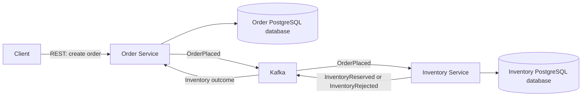

# Warexis

Warexis is an event-driven Order, Inventory & Fulfillment Platform. Its focus is distributed backend services and business workflows: coordinating orders, reserving stock, and eventually supporting fulfillment.

## Project status

Warexis has **independent core domains and REST APIs**. Order persists orders and order lines through a create/read API. Inventory persists stock and provides create/read/update APIs with database-backed invariants and serialized stock updates. Both services use Flyway migrations, JPA/Hibernate schema validation, Actuator health, and integration tests against real PostgreSQL using Testcontainers. Docker Compose provides local PostgreSQL and Kafka infrastructure. A GitHub Actions workflow verifies both services with Java 21; hosted execution awaits repository publication.

Kafka producers and consumers, event publication and processing, transactional outbox, idempotency, reservation logic, and reservation concurrency control remain planned. Orders currently stay in `PENDING_INVENTORY`; creating an order does not contact Inventory or reserve stock. Fulfillment, authentication/security, and a frontend are also future work.

## Motivation

Order processing spans independently owned data and operations that can fail at different times. Warexis provides a focused setting for implementing reliable asynchronous coordination, explicit domain ownership, and recovery from duplicate or delayed messages.

## High-level architecture

The diagram shows the planned business workflow. Kafka infrastructure exists, but the services do not yet publish or consume these events.



Order creation records a `PENDING_INVENTORY` order. In the planned messaging workflow, Inventory processing will reserve every requested line or reject the entire reservation. The asynchronous outcome will move the order to `CONFIRMED` or `REJECTED`. A successful create request will not imply that inventory has been reserved.

| Service | Planned domain ownership | Planned responsibility |
| --- | --- | --- |
| Order | Orders and order lines | Order creation and lifecycle transitions |
| Inventory | Stock and inventory reservations | Stock availability and all-or-nothing reservations |
| Fulfillment | To be defined later | Consume `OrderConfirmed` after the initial workflow is proven |

Each service owns its PostgreSQL data. Services must never directly read or modify another service's database. See the [architecture overview](docs/architecture/overview.md), [domain model](docs/architecture/domain-model.md), and [event contracts](docs/architecture/event-contracts.md).

## Technology direction

The service foundations use Java 21, Spring Boot 4.1.1, Maven, Flyway, JPA/Hibernate, and Actuator, with PostgreSQL integration tests using Testcontainers. Local infrastructure uses Docker / Docker Compose, PostgreSQL 18.6, and Apache Kafka 4.2.2. Application messaging integration is a later milestone.

GitHub Actions provides service verification. Keycloak, React, TypeScript, Playwright, observability, and local Kubernetes remain later milestones.

## Testing strategy

Both services have unit tests and real PostgreSQL Testcontainers integration/API tests covering migrations, persistence, request validation, and health. Inventory also verifies stock constraints and update locking. Reservation behavior and an operational Kafka workflow remain unimplemented.

Additional planned verification includes:

- Tests for event-driven lifecycle transitions and reservation decisions.
- PostgreSQL integration tests with Testcontainers for migrations, reservation atomicity, and concurrent stock updates.
- Kafka integration and contract tests for event publication, envelope validation, duplicate handling, and ordering assumptions.
- Workflow tests proving both inventory outcomes, eventual order transitions, and recovery after publication or processing failures.

Workflow tests will need to verify that business changes, consumer deduplication records, and outgoing events commit consistently.

## Local development direction

The local development environment uses Java 21 and Maven for the service foundations. Docker Compose provides separate PostgreSQL 18.6 containers for Order and Inventory and Apache Kafka 4.2.2 in a single-node KRaft setup, with persistent Docker volumes and health checks.

Each service has separate datasource configuration and data ownership. Flyway owns the Order and stock schemas; Hibernate validates them. Local environment files must remain untracked; `.env.example` files can document non-secret configuration.

Start the local infrastructure and host services using the [local development guide](infrastructure/local/README.md). See the [Order API](services/order-service/README.md) and [Inventory API](services/inventory-service/README.md) for request contracts and examples. These APIs are currently unauthenticated and intended for local development.

To verify both services independently:

```sh
(cd services/order-service && ./mvnw --batch-mode --no-transfer-progress verify)
(cd services/inventory-service && ./mvnw --batch-mode --no-transfer-progress verify)
```

Tests require Java 21 and a running Docker Engine. Testcontainers uses disposable PostgreSQL instances rather than the persistent Compose databases.

## Architecture decisions

- [ADR 0001: Service boundaries and database ownership](docs/architecture/adr/0001-service-boundaries-and-database-ownership.md)
- [ADR 0002: Asynchronous Kafka communication](docs/architecture/adr/0002-asynchronous-kafka-communication.md)
- [ADR 0003: Transactional outbox and idempotent consumers](docs/architecture/adr/0003-transactional-outbox-and-idempotent-consumers.md)

## Roadmap

1. Service foundations, architecture documentation, and local infrastructure are implemented.
2. Order creation/read APIs and Inventory stock management/read APIs have service-owned schemas and tests. Service verification CI is defined.
3. Next, implement atomic Inventory reservations and the Kafka workflow with transactional outboxes and idempotent consumers; verify duplicate delivery, concurrency, and failure recovery.
4. Introduce Fulfillment and `OrderConfirmed` only after the Order/Inventory workflow is proven.
5. Introduce authentication, an operational client interface, and observability as their prerequisites become stable.
6. Evaluate local Kubernetes and provisioning only when they solve a concrete requirement.
