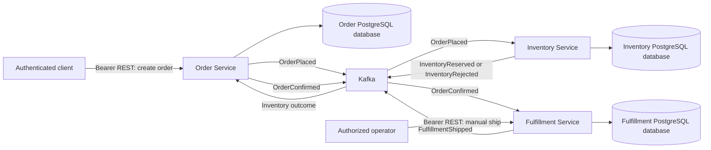

# Warexis

Warexis is an event-driven Order, Inventory & Fulfillment Platform. Its focus is distributed backend services and business workflows: coordinating orders, reserving stock, and recording manual fulfillment dispatch.

## Project status

Warexis implements three independently owned services: Order, Inventory, and Fulfillment. Order creation atomically stores an order and `OrderPlaced` outbox fact. Inventory makes an all-or-nothing reservation decision and publishes its outcome. Order accepts the first valid outcome, becomes `CONFIRMED` or `REJECTED`, and atomically stores `OrderConfirmed` on confirmation. Fulfillment consumes that confirmation to create one `PENDING` plan with the original ordered lines. An explicit manual ship command records `SHIPPED` and one `FulfillmentShipped` outbox fact.

The opt-in Kafka workflow uses idempotent local transactions, durable bounded retries, consumer-specific DLTs, and explicit recovery. Messaging defaults off. Each service owns its PostgreSQL database and Flyway schema. Docker Compose supplies three business databases, a local Kafka broker, and Keycloak with a separate identity database. Java 21 GitHub Actions jobs are defined for all three services and the packaged workflow; hosted execution awaits repository publication.

Manual dispatch does not contact a carrier, deduct Inventory stock, or change Order from `CONFIRMED`. The APIs require signed Bearer access tokens with issuer, audience and realm-role validation. Keycloak provides local identity, and the React operations frontend uses Authorization Code with PKCE for browser sign-in. Carrier integration and public deployment remain outside this implementation. See the [HTTP security model](docs/architecture/security.md).

## Motivation

Order processing spans independently owned data and operations that can fail at different times. Warexis provides a focused setting for implementing reliable asynchronous coordination, explicit domain ownership, and recovery from duplicate or delayed messages.

## High-level architecture

The diagram shows the implemented workflow when Kafka messaging is enabled.



Order creation records a `PENDING_INVENTORY` order and its event in one local transaction. Inventory processing can reserve every requested line or reject the entire reservation in its own local transaction; Kafka connects the two services when enabled. The asynchronous outcome moves the order to `CONFIRMED` or `REJECTED`. A successful create request does not imply that inventory has been reserved. Confirmation leads asynchronously to a Fulfillment plan; manual dispatch is a separate command. No current service subscribes to `FulfillmentShipped`.

| Service | Domain ownership | Responsibility |
| --- | --- | --- |
| Order | Orders and order lines | Order creation and lifecycle transitions |
| Inventory | Stock and inventory reservations | Stock availability and all-or-nothing reservations |
| Fulfillment | Fulfillment plans, original lines, and shipment references | Consume `OrderConfirmed`, expose read/manual ship APIs, and publish `FulfillmentShipped` |

Each service owns its PostgreSQL data. Services must never directly read or modify another service's database. See the [architecture overview](docs/architecture/overview.md), [domain model](docs/architecture/domain-model.md), and [event contracts](docs/architecture/event-contracts.md).

## Technology stack

The service foundations use Java 21, Spring Boot 4.1.1, Maven, Flyway, JPA/Hibernate, and Actuator, with PostgreSQL integration tests using Testcontainers. Local infrastructure uses Docker / Docker Compose, PostgreSQL 18.6, and Apache Kafka 4.2.2. Spring Kafka adapters connect the three-service workflow.

Spring Security OAuth2 Resource Server secures the HTTP APIs using local Keycloak 26.8.0 and JWT access tokens. GitHub Actions defines service, real-token security and authenticated workflow verification. The operations frontend uses React, TypeScript and Vite, with unit/component tests and a real-stack Playwright suite. Optional local Prometheus/Grafana metrics and OpenTelemetry/Tempo tracing support workflow diagnosis; trace export defaults off. Optional single-node local kind deployment is provided in the [Kubernetes guide](infrastructure/kubernetes/README.md).

## Testing strategy

All three services have unit tests and real PostgreSQL Testcontainers integration/API tests covering migrations, persistence, request validation, and health. Order verifies order/outbox atomicity. Inventory verifies stock constraints, update locking, all-or-nothing reservations, repeated SKUs, duplicate identities, rollback, and concurrent attempts without overselling. Service Kafka tests and a packaged-service workflow suite exercise real Kafka and PostgreSQL, including poison records, duplicate delivery, durable pause, restart, and recovery.

The [packaged-service workflow suite](tests/workflow/README.md) drives the three HTTP APIs through disposable Kafka and independent databases. Run `scripts/verify-workflow.sh` after the individual service suites. It covers business workflow, real-Keycloak authorization, operational metrics, trace causality and telemetry privacy; `scripts/verify-security.sh` runs only the security subset.

Workflow tests verify that business changes, consumer deduplication records, and outgoing events commit consistently.

## Local development

The local development environment uses Java 21 and Maven for the service foundations. Docker Compose provides separate PostgreSQL 18.6 containers for Order, Inventory, and Fulfillment and Apache Kafka 4.2.2 in a single-node KRaft setup, with persistent Docker volumes and health checks.

Each service has separate datasource configuration and data ownership. Flyway owns each service's domain, outbox, and processing schemas; Hibernate validates mapped entities. Local environment files must remain untracked; `.env.example` files can document non-secret configuration.

Start the local infrastructure and host services using the [local development guide](infrastructure/local/README.md). See the [Order API](services/order-service/README.md), [Inventory API](services/inventory-service/README.md), and [Fulfillment API](services/fulfillment-service/README.md) for request contracts and examples. Follow the [local Keycloak guide](infrastructure/auth/README.md) for required issuer/audience settings and safe test credentials; business APIs require the roles in the [authorization matrix](docs/architecture/security.md).

Additional guides:

- [Operations frontend](frontend/README.md): Node 24 setup, public browser configuration and frontend checks.
- [Disposable browser fixture](tests/browser-fixture/README.md): isolated services and identity for real-stack browser verification.
- [Local metrics](infrastructure/monitoring/README.md): authenticated Prometheus scraping and Grafana dashboards.
- [Local tracing](infrastructure/tracing/README.md): optional Tempo export, durable asynchronous context and privacy boundaries.
- [Local Kubernetes](infrastructure/kubernetes/README.md): optional single-node kind deployment, local images, persistence and focused acceptance procedures.

To verify all three services independently:

```sh
(cd services/order-service && ./mvnw --batch-mode --no-transfer-progress verify)
(cd services/inventory-service && ./mvnw --batch-mode --no-transfer-progress verify)
(cd services/fulfillment-service && ./mvnw --batch-mode --no-transfer-progress verify)
```

Tests require Java 21 and a running Docker Engine. Testcontainers uses disposable PostgreSQL instances rather than the persistent Compose databases.

## Architecture decisions

- [ADR 0001: Service boundaries and database ownership](docs/architecture/adr/0001-service-boundaries-and-database-ownership.md)
- [ADR 0002: Asynchronous Kafka communication](docs/architecture/adr/0002-asynchronous-kafka-communication.md)
- [ADR 0003: Transactional outbox and idempotent consumers](docs/architecture/adr/0003-transactional-outbox-and-idempotent-consumers.md)
- [ADR 0004: Capability event streams and bounded delivery](docs/architecture/adr/0004-message-topology-and-delivery-semantics.md)
- [ADR 0005: Fulfillment ownership and manual dispatch](docs/architecture/adr/0005-fulfillment-and-manual-dispatch.md)
- [HTTP security and authorization](docs/architecture/security.md)
- [Kafka workflow startup and recovery](docs/architecture/kafka-workflow.md)
- [Packaged-service workflow verification](tests/workflow/README.md)

## Roadmap

1. Service foundations, architecture documentation, and local infrastructure are implemented.
2. Order creation/read APIs and Inventory stock management/read APIs have service-owned schemas and tests. Service verification CI is defined.
3. Order and Inventory transactional outboxes, atomic Inventory reservations, and durable Inventory message/business uniqueness are implemented. Version 1 event contracts and delivery topology are documented.
4. Opt-in Kafka publishers/listeners, bounded durable delivery recovery, Order outcome transitions, and packaged-service workflow verification are implemented.
5. Fulfillment plans, manual dispatch, `OrderConfirmed`, and `FulfillmentShipped` extend the verified workflow with independent data ownership and recovery coverage.
6. Local Keycloak identity and stateless JWT resource-server authorization are implemented and verified against the three packaged services.
7. The operations frontend implements Authorization Code with PKCE, role-aware API workflows and real-stack browser regression. Local metrics and distributed tracing are implemented with explicit privacy and development-only boundaries.
8. Native Kubernetes manifests and local kind tooling provide an optional single-node deployment, with documented readiness, business workflow, persistence, restart and rollout verification procedures.
