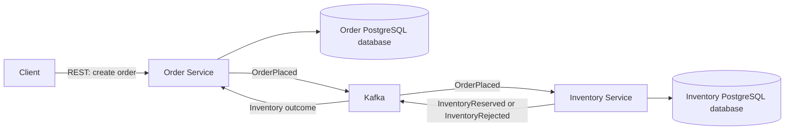

# Warexis

Warexis is an event-driven Order, Inventory & Fulfillment Platform. Its focus is distributed backend services and business workflows: coordinating orders, reserving stock, and eventually supporting fulfillment.

## Project status

Warexis has **independent core domains, REST APIs, and reliable local event foundations**. Order creation atomically persists orders, order lines, and a durable `OrderPlaced` outbox event. Inventory provides stock create/read/update APIs and an internal application use case for atomic reservations, durable duplicate handling, and inventory outcome outbox events. Both services use Flyway migrations, JPA/Hibernate schema validation, Actuator health, and integration tests against real PostgreSQL using Testcontainers. Docker Compose provides local PostgreSQL and Kafka infrastructure. A GitHub Actions workflow verifies both services with Java 21; hosted execution awaits repository publication.

The opt-in Kafka workflow connects both services through outbox publishers and idempotent listeners, with durable bounded retries, DLT routing, and explicit recovery. Orders start in `PENDING_INVENTORY` and later become `CONFIRMED` or `REJECTED`. Messaging defaults off; independent REST APIs remain available. Fulfillment, authentication/security, and a frontend remain future work.

## Motivation

Order processing spans independently owned data and operations that can fail at different times. Warexis provides a focused setting for implementing reliable asynchronous coordination, explicit domain ownership, and recovery from duplicate or delayed messages.

## High-level architecture

The diagram shows the implemented workflow when Kafka messaging is enabled.



Order creation records a `PENDING_INVENTORY` order and its event in one local transaction. Inventory processing can reserve every requested line or reject the entire reservation in its own local transaction; Kafka connects the two services when enabled. The asynchronous outcome moves the order to `CONFIRMED` or `REJECTED`. A successful create request will not imply that inventory has been reserved.

| Service | Domain ownership | Responsibility |
| --- | --- | --- |
| Order | Orders and order lines | Order creation and lifecycle transitions |
| Inventory | Stock and inventory reservations | Stock availability and all-or-nothing reservations |
| Fulfillment | To be defined later | Consume `OrderConfirmed` after the initial workflow is proven |

Each service owns its PostgreSQL data. Services must never directly read or modify another service's database. See the [architecture overview](docs/architecture/overview.md), [domain model](docs/architecture/domain-model.md), and [event contracts](docs/architecture/event-contracts.md).

## Technology direction

The service foundations use Java 21, Spring Boot 4.1.1, Maven, Flyway, JPA/Hibernate, and Actuator, with PostgreSQL integration tests using Testcontainers. Local infrastructure uses Docker / Docker Compose, PostgreSQL 18.6, and Apache Kafka 4.2.2. Spring Kafka adapters connect the initial Order/Inventory workflow.

GitHub Actions provides service verification. Keycloak, React, TypeScript, Playwright, observability, and local Kubernetes remain later milestones.

## Testing strategy

Both services have unit tests and real PostgreSQL Testcontainers integration/API tests covering migrations, persistence, request validation, and health. Order verifies order/outbox atomicity. Inventory verifies stock constraints, update locking, all-or-nothing reservations, repeated SKUs, duplicate identities, rollback, and concurrent attempts without overselling. Service Kafka tests and a packaged-service workflow suite exercise real Kafka and PostgreSQL, including poison records, duplicate delivery, durable pause, restart, and recovery.

The [packaged-service workflow suite](tests/workflow/README.md) drives both HTTP APIs through disposable Kafka and independent databases. Run `scripts/verify-workflow.sh` after the individual service suites.

Workflow tests verify that business changes, consumer deduplication records, and outgoing events commit consistently.

## Local development direction

The local development environment uses Java 21 and Maven for the service foundations. Docker Compose provides separate PostgreSQL 18.6 containers for Order and Inventory and Apache Kafka 4.2.2 in a single-node KRaft setup, with persistent Docker volumes and health checks.

Each service has separate datasource configuration and data ownership. Flyway owns each service's domain, outbox, and processing schemas; Hibernate validates mapped entities. Local environment files must remain untracked; `.env.example` files can document non-secret configuration.

Start the local infrastructure and host services using the [local development guide](infrastructure/local/README.md). See the [Order API](services/order-service/README.md) and [Inventory API](services/inventory-service/README.md) for request contracts and examples. These APIs are currently unauthenticated and intended for local development.

To verify both services independently:

```sh
(cd services/order-service && ./mvnw --batch-mode --no-transfer-progress verify)
(cd services/inventory-service && ./mvnw --batch-mode --no-transfer-progress verify)
```

Tests require Java 21 and a running Docker Engine. Testcontainers uses disposable PostgreSQL instances rather than the persistent Compose databases.

## Architecture decisions

- [ADR 0001: Service boundaries and database ownership](docs/architecture/adr/0001-service-boundaries-and-database-ownership.md)
- [ADR 0002: Asynchronous Kafka communication](docs/architecture/adr/0002-asynchronous-kafka-communication.md)
- [ADR 0003: Transactional outbox and idempotent consumers](docs/architecture/adr/0003-transactional-outbox-and-idempotent-consumers.md)
- [ADR 0004: Capability event streams and bounded delivery](docs/architecture/adr/0004-message-topology-and-delivery-semantics.md)
- [Kafka workflow startup and recovery](docs/architecture/kafka-workflow.md)
- [Packaged-service workflow verification](tests/workflow/README.md)

## Roadmap

1. Service foundations, architecture documentation, and local infrastructure are implemented.
2. Order creation/read APIs and Inventory stock management/read APIs have service-owned schemas and tests. Service verification CI is defined.
3. Order and Inventory transactional outboxes, atomic Inventory reservations, and durable Inventory message/business uniqueness are implemented. Version 1 event contracts and delivery topology are documented.
4. Opt-in Kafka publishers/listeners, bounded durable delivery recovery, Order outcome transitions, and packaged-service workflow verification are implemented.
5. Introduce Fulfillment and `OrderConfirmed` only after the Order/Inventory workflow is proven.
6. Introduce authentication, an operational client interface, and observability as their prerequisites become stable.
7. Evaluate local Kubernetes and provisioning only when they solve a concrete requirement.
