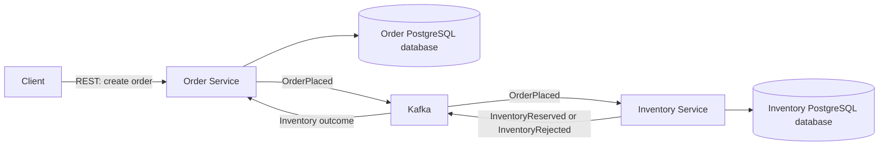

# Warexis

Warexis is an event-driven Order, Inventory & Fulfillment Platform. Its focus is distributed backend services and business workflows: coordinating orders, reserving stock, and eventually supporting fulfillment.

## Project status

Warexis is at the **foundation stage**. Order and Inventory have independent service foundations with PostgreSQL-ready datasource configuration, Flyway, JPA/Hibernate, Actuator health endpoints, and executable integration tests against real PostgreSQL using Testcontainers. Local PostgreSQL and Kafka infrastructure is available alongside architecture documentation and repository conventions.

Order and Inventory domain entities, Flyway business schema migrations, business REST APIs, Kafka producers and consumers, event publication and processing, transactional outbox, idempotency, reservation logic, and concurrency control remain planned. Fulfillment, authentication/security, and a frontend are also future work.

## Motivation

Order processing spans independently owned data and operations that can fail at different times. Warexis provides a focused setting for implementing reliable asynchronous coordination, explicit domain ownership, and recovery from duplicate or delayed messages.

## High-level architecture

The diagram shows the planned business workflow. Kafka infrastructure exists, but the services do not yet publish or consume these events.

In the planned workflow, order creation will record a `PENDING_INVENTORY` order. Inventory processing will reserve every requested line or reject the entire reservation. The asynchronous outcome will move the order to `CONFIRMED` or `REJECTED`. A successful create request will not imply that inventory has been reserved.

| Service | Planned domain ownership | Planned responsibility |
| --- | --- | --- |
| Order | Orders and order lines | Order creation and lifecycle transitions |
| Inventory | Stock and inventory reservations | Stock availability and all-or-nothing reservations |
| Fulfillment | To be defined later | Consume `OrderConfirmed` after the initial workflow is proven |

Each service owns its PostgreSQL data. Services must never directly read or modify another service's database. See the [architecture overview](docs/architecture/overview.md), [domain model](docs/architecture/domain-model.md), and [event contracts](docs/architecture/event-contracts.md).

## Technology direction

The service foundations use Java 21, Spring Boot 4.1.1, Maven, Flyway, JPA/Hibernate, and Actuator, with PostgreSQL integration tests using Testcontainers. Local infrastructure uses Docker / Docker Compose, PostgreSQL 18.6, and Apache Kafka 4.2.2. Application messaging integration is a later milestone.

Keycloak, React, TypeScript, GitHub Actions, Playwright, observability, and local Kubernetes may be introduced later when justified. They are outside the initial foundation.

## Testing strategy

Both service foundations have executable integration smoke tests against real PostgreSQL using Testcontainers. These foundation tests do not verify business schemas, reservation behavior, or an operational Kafka workflow.

Additional planned verification includes:

- Unit tests for domain rules and lifecycle transitions.
- PostgreSQL integration tests with Testcontainers for migrations, reservation atomicity, and concurrent stock updates.
- Kafka integration and contract tests for event publication, envelope validation, duplicate handling, and ordering assumptions.
- Workflow tests proving both inventory outcomes, eventual order transitions, and recovery after publication or processing failures.

Workflow tests will need to verify that business changes, consumer deduplication records, and outgoing events commit consistently.

## Local development direction

The local development environment uses Java 21 and Maven for the service foundations. Docker Compose provides separate PostgreSQL 18.6 containers for Order and Inventory and Apache Kafka 4.2.2 in a single-node KRaft setup, with persistent Docker volumes and health checks.

Each service has separate datasource configuration and data ownership. Flyway is configured, but business schema migrations remain planned. Local environment files must remain untracked; `.env.example` files can document non-secret configuration.

## Architecture decisions

- [ADR 0001: Service boundaries and database ownership](docs/architecture/adr/0001-service-boundaries-and-database-ownership.md)
- [ADR 0002: Asynchronous Kafka communication](docs/architecture/adr/0002-asynchronous-kafka-communication.md)
- [ADR 0003: Transactional outbox and idempotent consumers](docs/architecture/adr/0003-transactional-outbox-and-idempotent-consumers.md)

## Roadmap

1. Establish documentation, repository conventions, independent service foundations, PostgreSQL integration smoke tests, and local infrastructure (current foundation).
2. Implement Order and Inventory domain entities and service-owned Flyway business schema migrations.
3. Implement business REST APIs, order creation, inventory reservation rules, and concurrency control.
4. Implement the Kafka workflow with transactional outboxes and idempotent consumers; verify failure recovery and concurrency.
5. Introduce Fulfillment and `OrderConfirmed` only after the Order/Inventory workflow is proven.
6. Evaluate authentication, a client interface, automated delivery checks, and operational tooling as requirements emerge.
