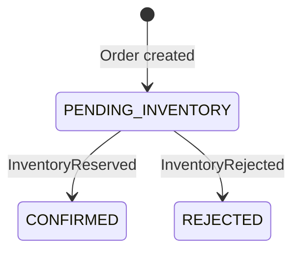

# Initial domain model

Order, OrderLine, and StockItem are implemented with service-owned Flyway schemas and UUID identifiers. InventoryReservation and the event-driven lifecycle transitions below remain conceptual. API details are documented in each service guide.

## Order Service

| Model | Fields | Responsibility |
| --- | --- | --- |
| Order | `id`, `status`, `createdAt`, `updatedAt`, order lines | Own the lifecycle of one order |
| OrderLine | `id`, `sku`, `quantity` | Identify requested stock and quantity within an order |

An order accepts 1–100 lines, a case-sensitive SKU matching `[A-Za-z0-9][A-Za-z0-9._-]{0,63}` for each line, and positive JSON integer quantities. Creation records `PENDING_INVENTORY`; the status has no public mutation endpoint. Inventory must consider the total requested quantity for each SKU, including repeated SKUs across lines.

`CONFIRMED` means inventory was reserved. It does not mean payment, shipment, or fulfillment occurred. `REJECTED` means inventory could not be reserved. These are terminal outcomes for the initial workflow; cancellation, replacement orders, and future fulfillment states require later design.

Repeated outcome deliveries must not repeat a transition. An outcome that conflicts with the recorded decision must not overwrite it silently; handling that inconsistency is an implementation requirement.

## Inventory Service

| Model | Fields | Responsibility |
| --- | --- | --- |
| StockItem | `id`, `sku`, `onHand`, `reserved` | Track stock quantities for a SKU |
| InventoryReservation | `id`, `orderId`, `status`, lines | Record the reservation decision for an order |

Reservation lines conceptually retain the requested SKU, quantity, and source order-line identifier. Proposed reservation statuses are `RESERVED` and `REJECTED`; these are design terms, not existing enums. A rejected reservation retains the attempted lines for its decision record without reserving them.

### Invariants

- `onHand >= 0`, `reserved >= 0`, and `reserved <= onHand`.
- `available = onHand - reserved`.
- A successful reservation increases `reserved` for every requested SKU in a single transaction.
- Missing stock or insufficient availability rejects the entire reservation and leaves stock unchanged.
- Concurrent reservations must not oversell stock.
- The initial workflow has one reservation decision per `orderId`; repeated processing returns or preserves that decision without changing stock again.

Stock invariants and SKU uniqueness are enforced by PostgreSQL constraints. Stock update requests use row locking. Reservation locking and transactional behavior remain implementation work. The all-or-nothing guarantee must be verified with real PostgreSQL concurrency tests.

Stock create/read/update APIs are implemented. Stock release, reservation expiry, and fulfillment deductions remain future work. See the [event contracts](event-contracts.md) for the messages connecting these domains.
