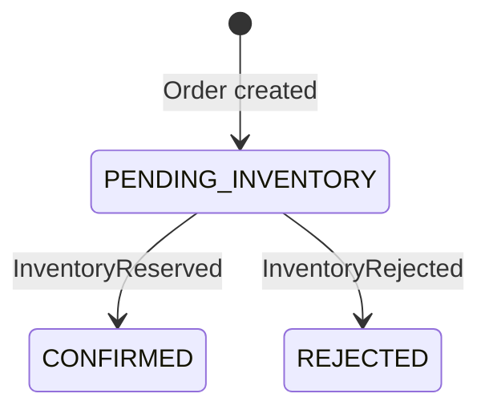

# Initial domain model

Order, OrderLine, StockItem, and InventoryReservation are implemented with service-owned Flyway schemas and UUID identifiers. Both services persist outgoing events in local transactional outboxes; Inventory also persists processed event identities. Order transitions driven by Kafka remain planned. API details are documented in each service guide.

## Order Service

| Model | Fields | Responsibility |
| --- | --- | --- |
| Order | `id`, `status`, `createdAt`, `updatedAt`, order lines | Own the lifecycle of one order |
| OrderLine | `id`, `sku`, `quantity` | Identify requested stock and quantity within an order |

An order accepts 1–100 lines, a case-sensitive SKU matching `[A-Za-z0-9][A-Za-z0-9._-]{0,63}` for each line, and positive JSON integer quantities. Creation atomically records `PENDING_INVENTORY` and an `OrderPlaced` outbox event; the status has no public mutation endpoint. Inventory must consider the total requested quantity for each SKU, including repeated SKUs across lines.

`CONFIRMED` means inventory was reserved. It does not mean payment, shipment, or fulfillment occurred. `REJECTED` means inventory could not be reserved. These are terminal outcomes for the initial workflow; cancellation, replacement orders, and future fulfillment states require later design.

Repeated outcome deliveries must not repeat a transition. An outcome that conflicts with the recorded decision must not overwrite it silently; handling that inconsistency is an implementation requirement.

## Inventory Service

| Model | Fields | Responsibility |
| --- | --- | --- |
| StockItem | `id`, `sku`, `onHand`, `reserved` | Track stock quantities for a SKU |
| InventoryReservation | `id`, `orderId`, `status`, lines | Record the reservation decision for an order |

Reservation lines retain the original requested SKU, quantity, and source order-line identifier in their original order. Reservation statuses are `RESERVED` and `REJECTED`. A rejected reservation retains the attempted lines and reason (`UNKNOWN_SKU` or `INSUFFICIENT_STOCK`) without reserving them. A missing SKU takes precedence over insufficient stock.

### Invariants

- `onHand >= 0`, `reserved >= 0`, and `reserved <= onHand`.
- `available = onHand - reserved`.
- A successful reservation increases `reserved` for every requested SKU in a single transaction.
- Missing stock or insufficient availability rejects the entire reservation and leaves stock unchanged.
- Concurrent reservations must not oversell stock.
- The initial workflow has one reservation decision per `orderId`; repeated processing returns or preserves that decision without changing stock again.

Stock invariants and SKU uniqueness are enforced by PostgreSQL constraints. Stock updates and reservations use database row locks. Reservation demand aggregates repeated SKUs using a wide integer, then locks stock rows in deterministic SKU order before checking availability. A single transaction persists the decision, any stock changes, processed event identity, and exactly one outcome outbox event. Real PostgreSQL tests cover atomicity and concurrent attempts.

Message uniqueness by `eventId` and business uniqueness by `orderId` are separate. The same event identity with the same original input returns the existing decision; changed input under that identity is a conflict. A new event identity for the same order and identical ordered lines records the delivery but reuses its original decision and outgoing event. A conflicting line list cannot obtain another decision. See the [event contracts](event-contracts.md) for exact identity rules and the future adapter quarantine policy.

Stock create/read/update APIs are implemented. Stock release, reservation expiry, and fulfillment deductions remain future work. See the [event contracts](event-contracts.md) for the messages connecting these domains.
