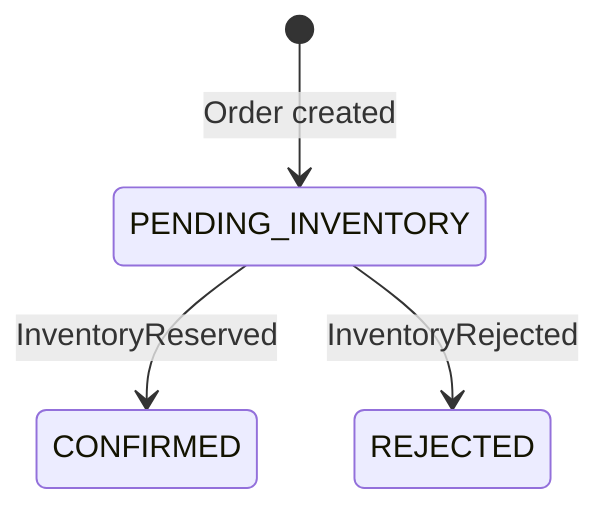
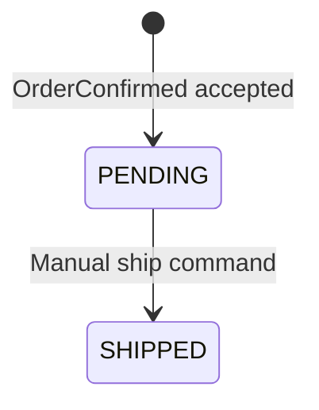

# Domain model

Order, OrderLine, StockItem, InventoryReservation, Fulfillment, and FulfillmentLine have service-owned Flyway schemas and UUID identities. All three services own their outgoing transactional outboxes and durable consumer delivery state. Business deduplication commits with each accepted input's local effects. API details are documented in the service guides.

## Order Service

| Model | Fields | Responsibility |
| --- | --- | --- |
| Order | `id`, `status`, `createdAt`, `updatedAt`, order lines | Own the lifecycle of one order |
| OrderLine | `id`, `sku`, `quantity` | Identify requested stock and quantity within an order |

An order accepts 1–100 lines, a case-sensitive SKU matching `[A-Za-z0-9][A-Za-z0-9._-]{0,63}` for each line, and positive JSON integer quantities. Creation atomically records `PENDING_INVENTORY` and an `OrderPlaced` outbox event; the status has no public mutation endpoint. Inventory must consider the total requested quantity for each SKU, including repeated SKUs across lines.

`CONFIRMED` means inventory was reserved. It does not mean payment, shipment, or fulfillment occurred. `REJECTED` means inventory could not be reserved. These remain terminal Order outcomes after manual Fulfillment dispatch. Cancellation, replacement orders, and an Order shipping state require separate design.

The first accepted success atomically records the decision, processed inventory event, `CONFIRMED` transition, and one `OrderConfirmed` outbox event. Rejection produces no confirmation. Repeated outcome deliveries must not repeat a transition or confirmation. An outcome that conflicts with the recorded decision must not overwrite it silently; the outcome handler quarantines such inconsistent input.

## Inventory Service

| Model | Fields | Responsibility |
| --- | --- | --- |
| StockItem | `id`, `sku`, `onHand`, `reserved` | Track stock quantities for a SKU |
| InventoryReservation | `id`, `orderId`, `status`, lines | Record the reservation decision for an order |

Reservation lines retain the original requested SKU, quantity, and source order-line identifier in their original order. Reservation statuses are `RESERVED` and `REJECTED`. A rejected reservation retains the attempted lines and reason (`UNKNOWN_SKU` or `INSUFFICIENT_STOCK`) without reserving them. A missing SKU takes precedence over insufficient stock.

### Invariants

- `onHand >= 0`, `reserved >= 0`, and `reserved <= onHand`.
- `available = onHand - reserved`.
- A successful reservation increases `reserved` for every requested SKU in a single transaction.
- Missing stock or insufficient availability rejects the entire reservation and leaves stock unchanged.
- Concurrent reservations must not oversell stock.
- The initial workflow has one reservation decision per `orderId`; repeated processing returns or preserves that decision without changing stock again.

Stock invariants and SKU uniqueness are enforced by PostgreSQL constraints. Stock updates and reservations use database row locks. Reservation demand aggregates repeated SKUs using a wide integer, then locks stock rows in deterministic SKU order before checking availability. A single transaction persists the decision, any stock changes, processed event identity, and exactly one outcome outbox event. Real PostgreSQL tests cover atomicity and concurrent attempts.

Message uniqueness by `eventId` and business uniqueness by `orderId` are separate. The same event identity with the same original input returns the existing decision; changed input under that identity is a conflict. A new event identity for the same order and identical ordered lines records the delivery but reuses its original decision and outgoing event. A conflicting line list cannot obtain another decision. See the [event contracts](event-contracts.md) for exact identity rules and the adapter quarantine policy.

Stock create/read/update APIs are implemented. Stock release, reservation expiry, and fulfillment deductions remain future work. See the [event contracts](event-contracts.md) for the messages connecting these domains.

## Fulfillment Service

| Model | Fields | Responsibility |
| --- | --- | --- |
| Fulfillment | `id`, `orderId`, `reservationId`, `confirmationEventId`, immutable causal origin, `status`, `createdAt`, `updatedAt`, `shippedAt`, `shipmentReference`, lines | Own one full-order manual dispatch plan |
| FulfillmentLine | `orderLineId`, original position, `sku`, `quantity` | Preserve the complete original ordered reservation snapshot |

Only a validated `OrderConfirmed` creates a plan. `OrderPlaced` is validated and acknowledged without creating one; Inventory outcomes cannot trigger fulfillment directly. Unique order, reservation, and first confirmation identities prevent duplicate plans. The processed-confirmation ledger protects event identity. Matching same-order aliases preserve the first origin and lines, including after shipping; changed known content, causal origin, reservation, or ordered lines is quarantined.

`PENDING` means awaiting manual dispatch. `SHIPPED` records an operator's handoff, using an internal case-sensitive reference matching `[A-Za-z0-9][A-Za-z0-9._-]{0,63}`. It does not mean carrier delivery. Shipment references are unique within Fulfillment. An identical repeated ship command returns the original projection and timestamp; changing a terminal reference or reusing another fulfillment's reference returns 409 with no mutation.

Planning atomically stores the fulfillment, all lines, and processed input. Shipping atomically stores `SHIPPED`, its reference/time, and one `FulfillmentShipped` outbox event. Database constraints and transaction locks enforce identity/reference ownership. Failures roll back the entire local operation. The output preserves the first confirmation as `payload.orderConfirmedEventId`; it omits `causationId` because the immediate trigger is a REST command.

Read APIs are `GET /api/fulfillments/{id}` and `GET /api/fulfillments/orders/{orderId}`. Manual dispatch uses `POST /api/fulfillments/{id}/ship` with `{"shipmentReference":"MANUAL-001"}`. No public create, list, or reset endpoint exists. Fulfillment does not modify Inventory stock or Order state; Order stays `CONFIRMED`.
