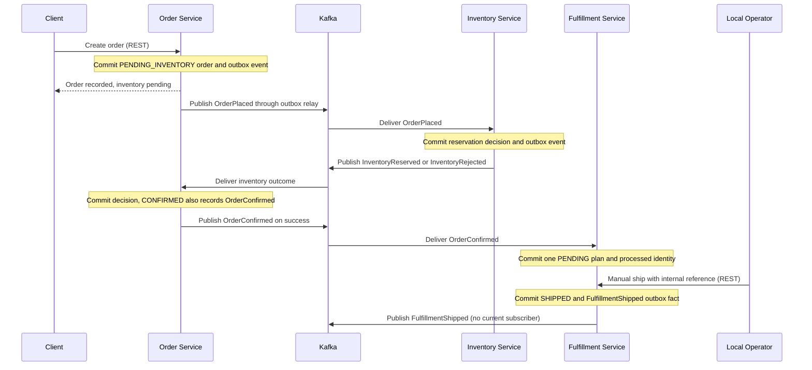

# Architecture overview

## Status and scope

Order, Inventory, and Fulfillment use Java 21, Spring Boot 4.1.1, Maven, independent PostgreSQL data ownership, Flyway migrations, schema validation, and Actuator health. Tests use real disposable PostgreSQL and Kafka. Local Docker Compose provides three independent PostgreSQL 18.6 containers and Apache Kafka 4.2.2 in a single-node KRaft setup, with persistent volumes and health checks.

The opt-in workflow coordinates inventory acceptance and manual dispatch. Order creation stores `OrderPlaced`. Inventory records an atomic reservation or rejection and its outcome. Order atomically records its terminal inventory decision and, for success, one `OrderConfirmed`. Fulfillment consumes that fact to create one immutable full-order plan in `PENDING`; a manual operator command moves it to `SHIPPED` and records one `FulfillmentShipped`. Messaging defaults off. Durable attempt budgets, relay/partition pause, and consumer-specific DLT routing bound recovery.

The HTTP APIs use stateless JWT resource-server authorization with local Keycloak and a separate identity database. See the [security model and endpoint matrix](security.md). The [operations frontend](../../frontend/README.md) uses the existing REST APIs and a public Keycloak client with Authorization Code and PKCE; its [API contract](../frontend/api-contracts.md) documents browser networking and current capabilities. Optional [local metrics](../../infrastructure/monitoring/README.md) and [tracing](../../infrastructure/tracing/README.md) support diagnosis without changing the business workflow. Carriers, payment, customer/address data and production identity/deployment remain outside this implementation.

## Ownership and communication

The domain boundaries assign orders, order lines, and the order lifecycle to Order, stock items and reservations to Inventory, and fulfillment plans, original line snapshots, and shipment references to Fulfillment. Each service controls its PostgreSQL database and Flyway migrations. Shared database tables, cross-service queries, and cross-service writes are prohibited.

REST handles client commands and queries. Order exposes create/read endpoints; Inventory exposes stock create/read/update endpoints; Fulfillment exposes read/manual ship endpoints. Their contracts are documented in the [Order guide](../../services/order-service/README.md), [Inventory guide](../../services/inventory-service/README.md), and [Fulfillment guide](../../services/fulfillment-service/README.md). Inventory decisions travel asynchronously through Kafka; an Order request must not wait on a synchronous Inventory call to complete the business workflow.

The following cross-service sequence runs when Kafka messaging is enabled.

Publication and delivery are separate operations. Messages can be delayed or delivered more than once. A pending order is a valid intermediate state, not evidence that stock is available.

## Consistency and reliability

- **Eventual consistency:** The three services do not share a transaction. An inventory decision may be committed before Order reflects it.
- **At-least-once delivery:** Publication and consumer recovery can create duplicates. Consumers must tolerate repeated deliveries.
- **Transactional outbox:** Order creation, Inventory reservation processing, Order confirmation, and manual Fulfillment dispatch commit their domain changes and outgoing events in the same local PostgreSQL transaction. The relay publishes committed events to Kafka, retaining event identity on retries.
- **Idempotent processing:** Inventory processed-event records commit with business changes and resulting outbox entries. A replay cannot reserve stock again. Order outcome processing persists deduplication with its lifecycle transition and confirmation intent. Fulfillment persists confirmation identities with its plan; duplicate commands cannot create a second plan or shipment fact.
- **Business invariants:** Transport deduplication by `eventId` alone is insufficient if equivalent commands arrive with different event IDs. Inventory must also prevent multiple successful reservations for the same order.
- **Ordering:** Workflow events use `orderId` as the Kafka record key. Kafka ordering is scoped to a partition within a topic; this provides no global or cross-topic ordering guarantee. Producers and consumers must preserve the required per-order processing order and validate state transitions.

The [version 1 event contracts](event-contracts.md) and [ADR 0004](adr/0004-message-topology-and-delivery-semantics.md) define capability streams, order keys, consumer groups, three-partition source/DLT topology, bounded technical retries, and explicit recovery. Consumers acknowledge only after their local transaction commits, or after confirmed DLT publication for an unprocessable record. All three services persist bounded delivery state and restore paused partitions on assignment. See [startup and explicit recovery](kafka-workflow.md).

## Identity and asynchronous tracing

Keycloak is an independent identity provider with its own PostgreSQL database. It handles sign-in, token issuance and realm roles without making business services own passwords or browser sessions. The React client uses Authorization Code with PKCE S256, keeps tokens in memory and sends Bearer tokens to each service through the local same-origin proxy. Each API validates signature, issuer, audience and roles. No access token is propagated through business events. See the [HTTP security model](security.md).

When optional tracing is enabled, a local transaction stores a nullable `traceparent` beside its outbox event. Relay spans preserve that durable origin across restart, and Kafka consumers continue the incoming producer context. Processing retries appear as sibling attempts. Manual dispatch uses the current HTTP request and links to the first confirmation origin. Trace export strips business identifiers, payloads and credentials; it can drop telemetry without changing transaction or acknowledgment behavior. [The tracing guide](../../infrastructure/tracing/README.md) details context boundaries and privacy.

Optional Prometheus scrapes authenticated service metrics; Grafana queries Prometheus and, with the tracing overlay, Tempo. These local diagnostics are separate from the business workflow. The single-node Kubernetes deployment does not include the monitoring stack.

## Inventory transaction boundary

Reservation is all-or-nothing across an order's lines in one Inventory transaction. The internal application service validates original lines, aggregates demand for repeated SKUs, locks stock rows in deterministic order, and records the reservation decision, processed-event identity, and corresponding outcome outbox event. A rejected reservation leaves stock quantities unchanged. Unique order and event identities protect against repeated delivery; conflicting identities fail without business mutation. A Kafka adapter invokes the application service; no public reservation HTTP endpoint exists.

`available = onHand - reserved`. Reserving increases `reserved`; it does not reduce `onHand`. Confirmation in Order does not consume the stock a second time. Manual dispatch does not modify stock or reservations. Stock release and physical consumption remain future work.

## Fulfillment transaction boundary

A validated `OrderConfirmed` creates one plan per order and reservation, preserving line IDs, case-sensitive SKUs, quantities, and array order. Event identity, order identity, reservation ownership, and causal origin are checked independently. Matching aliases retain the first confirmation identity and any `SHIPPED` state; conflicting content goes to the Fulfillment group's DLT without changing the plan.

`POST /api/fulfillments/{id}/ship` accepts an internal `shipmentReference`. The only transition is `PENDING → SHIPPED`. State, reference, timestamp, and one stored `FulfillmentShipped` event commit together. Identical repeats return the original projection; changed terminal references or references already owned by another fulfillment return 409. Dispatch records a local manual handoff, without carrier interaction or delivery confirmation.

Order retains `CONFIRMED` after dispatch. No service currently consumes `FulfillmentShipped`, and no cross-service database access or second stock deduction occurs. See [ADR 0005](adr/0005-fulfillment-and-manual-dispatch.md).

## Related design

- [Domain model](domain-model.md)
- [Version 1 event contracts](event-contracts.md)
- [Service ownership decision](adr/0001-service-boundaries-and-database-ownership.md)
- [Messaging decision](adr/0002-asynchronous-kafka-communication.md)
- [Reliability decision](adr/0003-transactional-outbox-and-idempotent-consumers.md)
- [Topology and delivery decision](adr/0004-message-topology-and-delivery-semantics.md)
- [Fulfillment ownership and manual dispatch](adr/0005-fulfillment-and-manual-dispatch.md)
